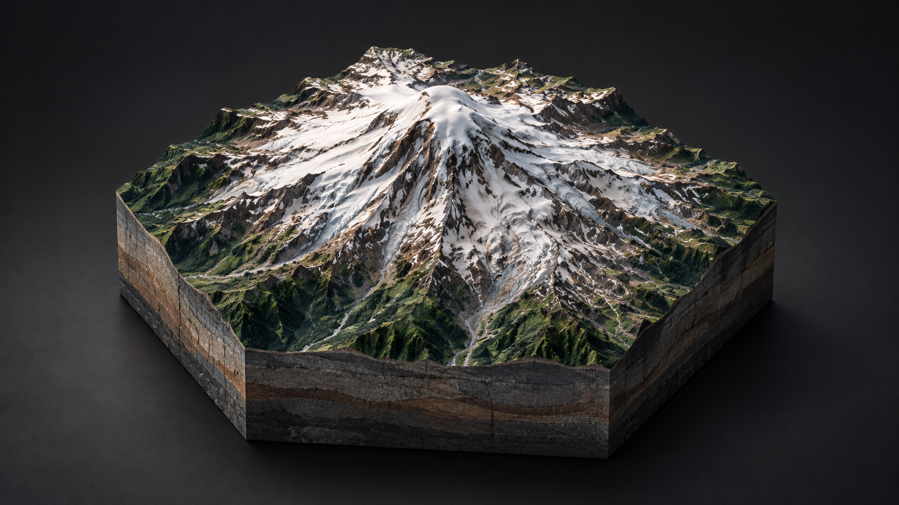

# Maquette

A Swift package that renders **configurable terrain chunks of the real world** — a slice of the
earth lifted out of the ground and set on a table. Real elevation and satellite imagery on top,
geological strata down the cut sides, a closing face underneath: a solid, not a draped map.



*Generated concept illustration inspired by the Mount Rainier demo.*

- **visionOS** — a volumetric diorama in the room; drag to pan, pinch to zoom the ground.
- **iOS / iPadOS** — an interactive 3D view; one finger slides the terrain, two orbit and pinch.
  Optional AR placement puts the chunk on a real table at its true physical size.
- **macOS** — the same scene under trackpad and mouse: drag pans, option-drag orbits, pinch or
  scroll zooms.

Zoom out far enough — fingers pinching together — and the chunk dissolves into a globe you can
spin; zoom back in to cut a new chunk wherever you left it pointing.

## Quick start

```swift
import Maquette
import SwiftUI

struct CanyonView: View {
    @State private var position: DioramaCameraPosition = .automatic
    @State private var selected: DioramaFeature.ID?

    var body: some View {
        DioramaView(
            region: DioramaRegion(
                center: CLLocationCoordinate2D(latitude: 36.0544, longitude: -112.1401),
                radius: 6000
            ),
            position: $position,
            selection: $selected
        ) {
            DioramaMarker("Yavapai Point",
                          coordinate: CLLocationCoordinate2D(latitude: 36.0667, longitude: -112.1170),
                          tint: .orange)
        }
        .dioramaStyle(.standard(exaggeration: 1.6, chunk: .canyon))
        .dioramaLoadingPolicy(.prefetchMargin(0.8))
        .globeTransition()
    }
}
```

The API follows MapKit's SwiftUI shape: the initializer carries *place and interaction*
(`DioramaRegion`, `DioramaInteractionModes`, a `DioramaCameraPosition` binding, a selection
binding), modifiers carry *style and observation* (`.dioramaStyle`, `.dioramaEffect`,
`.onDioramaCameraChange`, `.onDioramaLoadingChange`), and a result builder carries *content*
(`DioramaMarker`, `DioramaPolyline`, bare GeoJSON `Feature`s, or a whole decoded
`FeatureCollection`). The region and style are live — hand the view different ones and the diorama
relocates or rebuilds in place.

For before/after examples and compatibility details, see
[[migrating-to-the-swiftui-api|Migrating to the SwiftUI API]] in the DocC catalog
(`Sources/Maquette/Maquette.docc`).

## Compose and select content

Use a `DioramaContent` body to build reusable content, and SwiftUI `ForEach` to draw your models.
Selection accepts `Hashable & Sendable` values such as UUIDs or enums. A tag identifies the selected
model; the collection ID keeps its rendered marker stable when its title or coordinate changes.

```swift
// places contains Identifiable values with UUID IDs and a coordinate property.
@State private var selectedPlace: UUID?

DioramaView(region: region, selection: $selectedPlace) {
    ForEach(places) { place in
        DioramaMarker(place.name, coordinate: place.coordinate)
            .tint(.orange)
            .tag(place.id)
    }
    DioramaPolyline(coordinates: trail)
        .stroke(.blue, width: .physicalMeters(0.003))
}
```

Existing String selection bindings continue to select untagged markers by annotation ID. Tapping
an already selected marker clears selection; markers sharing a tag select together. Off-chunk or
removed content leaves the application selection intact. Tagged polylines, polygons, circles, and image overlays also participate in typed selection. Polygon holes and clipped-away geometry do not select. iOS/iPadOS/macOS line picking uses an independent 8-point tolerance; visionOS uses a wider spatial target. Shape selection writes the binding; use that value to choose a selected fill or stroke.

Content modifiers also support `.altitudeReference(.relativeToGround)`. Widths use explicit `.physicalMeters` or `.geographicMeters` units. A modifier on a group supplies defaults; modifiers inside its children
win. Existing initializer styling and custom content that implements `items` remain supported.

## Geographic overlays

```swift
DioramaView(region: region, selection: $selectedPlace) {
    DioramaPolygon(parkPolygon, id: "park") // Polygon supports exterior + holes
        .fill(.green.opacity(0.2))
        .stroke(.green, style: DioramaStrokeStyle(
            width: .geographicMeters(12), lineCap: .round, lineJoin: .round,
            dash: [80, 40]
        ))
        .tag(parkID)
    DioramaCircle(center: center, radius: 500) // geographic meters
        .fill(.blue.opacity(0.2))
        .stroke(.blue, width: .physicalMeters(0.003))
    DioramaImageOverlay(image: surveyImage, bounds: surveyBounds)
        .opacity(0.6)
}
```

Create `surveyImage` with `DioramaImageResource(id:revision:image:attribution:)` from a decoded
`CGImage`. Increment its revision when its pixels change. Images are north-up, retain their original
UV extent when clipped, and add their credit alongside the terrain provider's credit. Opacity edits
reuse the texture. Dash lengths and phase use the stroke width's unit system.

GeoJSON polygons and `DioramaFeature(feature)` use the same holes-aware rendering path. The old
GeoJSON wrapper names `DioramaAnnotation` and `AnnotationStyle` are now `DioramaFeature` and
`DioramaFeatureStyle`; custom SwiftUI annotation labels are planned separately.

These overlays conform to raster terrain triangles. Ground-relative placement over photorealistic
3D Tiles is unavailable: unsupported overlays are omitted with a diagnostic instead of appearing on
a false flat surface. Absolute-altitude placement remains available. Geometry updates are asynchronous
and pending shapes are hidden until ready. Fill, color, opacity, selection, and image revision changes
update existing resources without fetching terrain; shape, altitude, and stroke geometry changes
rebuild overlay buffers. This does not establish a per-frame overlay performance guarantee.

## Control geographic navigation

Use `initialRegion:` for an initial place, `region:` for live region inputs, or `groundPosition:`
when your app needs to drive and observe geographic navigation. The ground binding owns the center
and absolute radius; the separate `position:` binding controls the orbit camera.

```swift
@State private var ground = DioramaGroundPosition(region: canyonRegion)

DioramaView(groundPosition: $ground)
    .dioramaShape(.hexagonal)
    .dioramaPhysicalSize(0.8)
    .onDioramaNavigationChange(frequency: .onEnd) { context in
        saveLastRegion(context.position.region)
    }

// Recenter at the current geographic scale:
ground = DioramaGroundPosition(region: DioramaRegion(
    center: destination, radius: ground.region.radius
))
```

Ground requests rebuild at the requested region. Gestures write the applied center and radius back
without triggering another load. `positionedByUser` identifies gesture read-back, and callbacks also
report phase and origin. The camera in a navigation context is `nil` on visionOS. Globe steering is
reported when the return commits and its chunk arrives.

Panning now works with the default interaction modes. `.dioramaLoadingPolicy(.automatic)` provisions
a margin; `.prefetchMargin(0.8)` tunes it and `.prefetchMargin(0)` keeps a fixed chunk. Existing style
`panRange` arguments still work. Camera observers can use
`.onDioramaCameraChange(frequency: .onEnd)` for settled updates; the original camera-only closure
remains available.

## Add diorama controls

```swift
DioramaView(initialRegion: region)
    .dioramaControls(alignment: .topLeading) {
        VStack {
            DioramaCompass()
            DioramaResetButton()
        }
        .buttonStyle(.bordered)
    }
```

Each overlay controls its own diorama. Reset returns to the last app-requested geography and
orbit while preserving appearance, content, and selection. The compass faces north in iOS/macOS
orbit views; it hides in AR, visionOS volumes, globe presentation, and route-follow mode. Reset
preserves AR and volume placement. Choose the controls' layout and button style in the builder.

## Own the loading UI

```swift
DioramaView(initialRegion: region)
    .dioramaLoadingOverlay { context in
        if case .loading = context.state {
            ProgressView("Preparing diorama")
        } else if case .failed = context.state {
            Button("Try again") { context.retry() }
        }
    }
```

The custom overlay replaces the default loading, error, and streaming UI. Use
`.dioramaLoadingOverlayHidden()` when loading is displayed elsewhere. Required source attribution
continues to display independently.

## Features

- **Terrain chunks** cut to any outline — circles, polygons, arbitrary concave shapes, or a real
  GeoJSON boundary (`DioramaRegion(fitting:)` + `DioramaShape.geoJSON(_:)` frame and cut a city
  limit or park boundary at true scale).
- **Unbounded panning**: the outline stays put while the world slides beneath it, fetching tiles
  as it goes; **ground zoom** widens the map under the fixed chunk, all the way out to a globe.
- **Photorealistic 3D Tiles** (Google, Cesium ion) clipped to the same outlines, with the required
  per-tile attribution aggregated and displayed automatically.
- **Effects**: hologram contours, inked-illustration, and terraced contour-model treatments, all
  applied over the chunk already in hand.
- **OSM buildings** extruded over the terrain (prototype).
- **GeoJSON-native**: the `Geo` layer speaks RFC 7946 directly and ships Turf-style measurement
  (`Turf.distance`, `bearing`, `destination`, booleans, and more).
- **AR placement** on iOS/iPadOS via `.dioramaARPlacement(_:)` — RealityView-native
  (`SpatialTrackingSession`), no ARView.
- Swift 6 strict concurrency, `@Observable` only, zero dependencies, no bundled resources.

## Platforms

| Platform | Minimum | Notes |
|----------|---------|-------|
| visionOS | 2.0 | Volumetric window; drag pans, pinch zooms the ground |
| iOS / iPadOS | 18.0 | Touch gestures; AR placement |
| macOS | 15.0 | Trackpad/mouse; pinch and scroll-wheel zoom |

The floors are set by `LowLevelMesh`, which is what makes panning a buffer write instead of a
per-frame mesh compile. watchOS has no RealityKit and cannot be supported.

## Data sources and keys

| Source | Key | Default |
|--------|-----|---------|
| ESRI World Imagery | none | imagery default |
| Mapzen Terrarium (AWS) | none | elevation default |
| MapTiler satellite / terrain | API key | `.mapTilerSatellite(apiKey:)` / `.mapTiler(apiKey:)` |
| Google Photorealistic 3D Tiles | API key | `.photorealistic(provider: GoogleTiles3DProvider(apiKey:))` |
| Cesium ion | access token | `CesiumIonTiles3DProvider(accessToken:assetId:)` |

Google bills the **root tileset request only** (~one event per diorama load); the provider caches
the root so preset switches and relaunches stay free. **Attribution**: the library displays the
per-tile source credits automatically, as the services require; Google additionally requires its
logo on screen, which your app must place — see the
[Map Tiles API policies](https://developers.google.com/maps/documentation/tile/policies).

## Demo

`Demo/` contains an iOS demo app (XcodeGen project) with presets covering every feature — chunks,
outlines, photorealistic tiles, panning, effects, buildings, and the globe handoff. See
[Demo/README.md](Demo/README.md).

## License

MIT — see [LICENSE](LICENSE).
